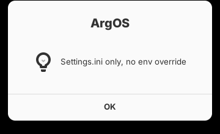
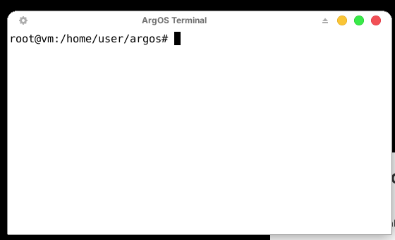
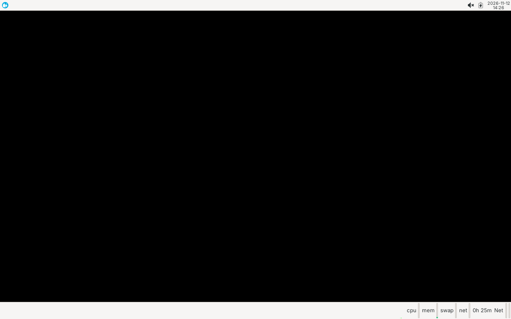

<p align="center">
  
</p>

# ArgOS

ArgOS is a Kali-rolling-based security/pentesting live distro, built with
[live-build](https://wiki.debian.org/DebianLive) (the same tool Kali itself
is built with), bootstrapped directly from Kali's own `kali-rolling`
repository rather than reimplementing anything Kali already maintains. It
ships a real Xfce desktop (Kali's own default), a graphical installer
(Calamares), and an extensive CLI pentest toolset on top.

ArgOS started as a CLI-only, no-desktop live system — that constraint has
since been deliberately dropped in favor of a proper desktop + installer
experience closer to Kali's own live image. Some package-list comments
still describe the CLI-only-era reasoning for excluding specific GUI
tools (Burp, Wireshark's GUI, Maltego, GHIDRA, etc.); those exclusions
haven't been revisited yet now that there's a desktop to run them on.

## Architecture

Top to bottom: what a running ArgOS session is actually made of, and
what each layer depends on below it. Every component named here is
real and already covered elsewhere in this README — nothing in this
diagram is aspirational.

```
┌──────────────────────────────────────────────────────────────────────────┐
│ USER                                                                      │
│   Live session: argos / argos, passwordless sudo (change it!)            │
│   Installed system: real account from Calamares, replaces the above      │
└──────────────────────────────────┬───────────────────────────────────────┘
                                    │
┌───────────────────────────────────▼──────────────────────────────────────┐
│ DESKTOP / UI  (optional -- the live session boots straight into this)    │
│   lightdm (autologin) → Xfce session → Whisker Menu (ArgOS's own,        │
│     8 flat categories, replaces kali-menu's 64-entry MITRE tree)         │
│   Theme: ArgOS (GTK3 + xfwm4, macOS Tahoe-style, light, built from       │
│     MacTahoe-gtk-theme) · MacTahoe-icon-theme (blue) -- static           │
│     xfconf-perchannel XML                                                │
│   Panel: 3 top panels acting as one menu bar (menu+tool-finder left ·    │
│     clock center · metrics+status icons right) + a centered,            │
│     shrink-wrapped bottom dock (xfce4-docklike-plugin alone)             │
│     (argos-setup-panel-widgets, configured once via direct               │
│      xfconf-query writes)                                                │
│   Desktop: ArgOS wallpaper (argos-set-wallpaper, any monitor layout) ·    │
│     "Install ArgOS" icon → launches Calamares (graphical installer)      │
└───────────────────────────────────┬──────────────────────────────────────┘
                                    │
┌───────────────────────────────────▼──────────────────────────────────────┐
│ ARGOS'S OWN TOOLING  (userspace -- C, plus shell for simple glue)        │
│   argosd (daemon)        hardening sysctls; watches default-pw + sshd    │
│   argos-triage (CLI)     nmap-output triage, ranked, optional --ai       │
│   argos-toolfinder (CLI) "what tool do I use for X" keyword search       │
│   argos-selftest (CLI)   tool-rot / installed-but-broken detector        │
│   argos-setup-persistence   encrypted (LUKS-only) live-USB persistence   │
│   argos-set-wallpaper / argos-setup-panel-widgets   desktop provisioning │
└───────────────────────────────────┬──────────────────────────────────────┘
                                    │
┌───────────────────────────────────▼──────────────────────────────────────┐
│ PENTEST TOOL CATEGORIES  (277+ packages, sourced from kali-rolling)      │
│   recon · web · password · wireless · exploit ·                          │
│   forensics · reverse-engineering · post-exploit                         │
│   (which OSI layer each category actually operates at -- below)          │
└───────────────────────────────────┬──────────────────────────────────────┘
                                    │
┌───────────────────────────────────▼──────────────────────────────────────┐
│ BASE USERSPACE / PACKAGE LAYER                                           │
│   bash/zsh, coreutils  ⇄  apt + dpkg  ⇄  kali-rolling (kali.download)    │
│   nftables -- default-deny firewall (/etc/nftables.conf)                 │
└───────────────────────────────────┬──────────────────────────────────────┘
                                    │
┌───────────────────────────────────▼──────────────────────────────────────┐
│ INIT / SYSTEM SERVICES  (systemd)                                        │
│   argosd.service (enabled) · nftables.service (enabled)                  │
│   lightdm.service (enabled) · ssh.service (masked by default)            │
│   ssh-hostkeys-regen.service (oneshot, runs before ssh.service)          │
│   apt-daily.timer / apt-daily-upgrade.timer (masked)                     │
└───────────────────────────────────┬──────────────────────────────────────┘
                                    │
┌───────────────────────────────────▼──────────────────────────────────────┐
│ BOOT CHAIN  (firmware to PID 1)                                          │
│   GRUB (BIOS grub-pc + UEFI grub-efi, ArgOS theme/distributor) →         │
│   Plymouth (script module: static logo + real boot-progress bar) →      │
│   initramfs / live-boot (squashfs root, zstd compression,                │
│     `persistence persistence-encryption=luks` boot params) →             │
│   systemd (PID 1)                                                        │
└───────────────────────────────────┬──────────────────────────────────────┘
                                    │
┌───────────────────────────────────▼──────────────────────────────────────┐
│ LINUX KERNEL  (linux-image-amd64, Kali's build + firmware-* packages)    │
│   netfilter/nf_tables       -- backs the firewall                        │
│   device-mapper / dm-crypt -- LUKS persistence partition                 │
│   VFS: ext4 (persistence) + squashfs (read-only root) + overlay          │
│   sysctl hardening applied by argosd at boot: rp_filter, kptr_restrict,  │
│     dmesg_restrict, yama/ptrace_scope, tcp_syncookies                    │
└───────────────────────────────────┬──────────────────────────────────────┘
                                    │
┌───────────────────────────────────▼──────────────────────────────────────┐
│ HARDWARE                                                                  │
│   CPU · RAM · disk/USB · network interface(s) · GPU (optional, hashcat)  │
└────────────────────────────────────────────────────────────────────────────┘
```

### Where "Layer 7" fits: OSI mapping for the tool categories

A pentest distro's tool categories mostly *are* a tour of the OSI
model — each one operates at a specific layer of whatever it's
attacking, which is worth making explicit rather than leaving implicit:

| OSI layer | Name | ArgOS components operating here |
|---|---|---|
| 7 | Application | Web tools (`sqlmap`, `nuclei`, `ffuf`, `gobuster`), post-exploit protocol abuse (`netexec` over SMB, `evil-winrm` over WinRM, `responder` over LLMNR/NBT-NS), recon's DNS/LDAP/SMB enumeration, `argos-triage` itself (reads service banners nmap already resolved at this layer) |
| 6 | Presentation | TLS/encoding inspection (`sslscan`, `sslyze`, `testssl.sh`) |
| 5 | Session | Post-exploit tunneling/pivoting (`chisel`, `proxytunnel`, `iodine`), SMB/Kerberos session handling (`impacket-scripts`) |
| 4 | Transport | Port scanning (`nmap`, `masscan` — TCP/UDP), the firewall's actual filtering decisions (`nftables`), online brute-forcing over established TCP sessions (`hydra`, `medusa`) |
| 3 | Network | `nftables` routing/filtering, `arp-scan`/`netdiscover`, `ike-scan` (IPsec), `traceroute` |
| 2 | Data link | The wireless category almost entirely lives here: `aircrack-ng`, `wifite`, `reaver`/`bully` (802.11 frames), `macchanger`, `kismet`, `bluez` |
| 1 | Physical | Wireless/SDR hardware itself, `i2c-tools` for bus-level access |

Forensics and reverse-engineering sit outside this mapping entirely —
they operate on disk images and binaries, not network layers.

## What's here

```
auto/config                    live-build invocation (distribution, arch, bootloader, mirrors)
auto/clean                     wrapper around `lb clean`
config/package-lists/*.list.chroot   tool sets, one file per category, plus desktop.list.chroot
config/preseed.cfg              debconf answers so the build never blocks on a prompt
config/hooks/normal/*.hook.chroot    default user, sshd-off, boot theming, argos-tools build, cleanup
config/includes.chroot/         files dropped verbatim into the chroot (Plymouth + GRUB themes,
                                 /etc/argos/ config, /usr/src/argos-tools/ original C tooling)
assets/                         logo source + the derived splash images
Dockerfile                      Kali-rolling + live-build build environment
build.sh                        `lb clean && lb config && lb build` wrapper
```

## Building the ISO

This is **not run automatically** — building takes real root, network
access, ~20-30GB of free disk, and 20-60 minutes.

On a real Debian/Kali host, as root:

```bash
sudo ./build.sh
```

Or via Docker (the container needs `--privileged` because live-build does
chroot/mount/loopback work that an unprivileged container can't):

```bash
docker build -t argos-os-builder .
docker run --rm --privileged -v "$PWD:/build" argos-os-builder -c "cd /build && ./build.sh"
```

The resulting `.iso` lands in the project root.

`build.sh` runs `scripts/argos-preflight.sh` first automatically: it
checks every package in `config/package-lists/` against the live
`kali-rolling` archive before committing to the full build. This exists
because it happened to us directly building ArgOS itself — `nikto` and
`wpscan` were verified present when their list was written, then simply
gone from the archive by a later build attempt (a rolling release has
no staging/QA layer, so packages can disappear or get renamed with no
warning). Catching that in 10 seconds beats finding out 40 minutes into
a build. Run it standalone any time with `./scripts/argos-preflight.sh`,
or skip it with `sudo ./build.sh --skip-preflight` if you're confident
the lists are current (or have no network path to the mirror from
wherever this check would run).

`auto/config` and `auto/clean` were verified by actually installing
Kali's real `live-build` package (`1:20250814+kali3`, pulled straight
from `kali.download`) and running `lb clean`/`lb config` against this
repo, not written from flag names recalled from memory or tested only
against Debian/Ubuntu's own packaging of live-build, which uses
different flag spellings for several of these (plural vs. singular
`--architecture`/`--binary-image`/`--bootloaders`, and
`--debootstrap-options` vs. `--bootstrap-keyring`) and lacks others
entirely. If `lb config` errors on a different live-build version, run
`lb config -u` to see what that version actually accepts.

## Running ArgOS in a VM

These are specs for *running* a built ISO in a VM — separate from
what *building* the ISO needs (root, network, ~20-30GB free, 20-60
minutes; see above). The live desktop image is noticeably heavier than
a CLI-only system would have been, since boot now means lightdm + a
full Xfce session, not a console login.

| | CPU | RAM | Disk | Notes |
|---|---|---|---|---|
| **Minimum** | 2 cores | 4 GB | 20 GB | Boots, logs into Xfce, runs individual tools one at a time. Will feel slow under real load. |
| **Recommended** | 4 cores | 8 GB | 40-60 GB | Comfortable desktop use, a single-target engagement, moderate wordlists. |
| **Heavy workloads** | 6-8+ cores | 16 GB+ | 80-100+ GB | Large wordlist/hash-cracking jobs, multiple tools running at once, big packet captures. |

Why these numbers, not round guesses: the actual installed system
(all 277+ packages plus dependencies) is ~7GB — computed by summing
real `Installed-Size` data from Kali's package index with full
dependency-closure resolution, not estimated (see the package
categories section). The compressed `.iso` itself lands around 3.5-4GB.
4GB RAM is enough to boot and run the squashfs + an Xfce session, but
gets tight fast once you're also running tools that use real memory.

Three things that matter more than the raw numbers:

- **No persistence partition = writes go to RAM.** `live-boot`'s
  overlay is tmpfs-backed when there's no persistence partition
  mounted — every temp file, downloaded wordlist, packet capture, or
  cracking job's scratch space is consuming RAM directly, on top of
  whatever's actually running. Set up `argos-setup-persistence` (see
  above) before doing anything data-heavy without a disk-backed
  option, or budget considerably more RAM than the table above if you
  won't.
- **Wireless tools need a real wireless NIC passed through, not the
  VM's virtual network adapter.** `aircrack-ng`/`wifite`/monitor mode
  require actual 802.11 hardware; a hypervisor's NAT/bridged virtual
  NIC can't do monitor mode or packet injection at all. Pass a USB
  WiFi adapter through to the VM (VirtualBox supports USB passthrough
  reasonably well) if you want these tools to do anything real.
- **GPU passthrough for `hashcat` is a hypervisor-specific, advanced
  setup, and VirtualBox specifically doesn't support it.** KVM/QEMU
  with VFIO does; VirtualBox doesn't do real GPU passthrough at all.
  Without it, `hashcat` still runs via CPU-based OpenCL (`libpocl2t64`
  is already pulled in as a dependency), just far slower than an
  actual GPU would give you — expect this for cracking jobs unless
  you're on a hypervisor and host that actually supports VFIO
  passthrough.

## Performance choices

Two deliberate speed decisions, both config/hooks-level (no custom
packaging needed):

- **`--chroot-squashfs-compression-type zstd`** in `auto/config`. The
  live root filesystem is read through this compression on every file
  access while running from USB/live media, not just once at boot;
  `zstd` decompresses markedly faster than live-build's `xz` default for
  a modest size cost, which is almost always the right trade for a live
  OS (build-time compression ratio barely matters; runtime decompression
  speed does, constantly).
- **`config/hooks/normal/0250-disable-background-timers.hook.chroot`**
  masks `apt-daily.timer`/`apt-daily-upgrade.timer` (shipped by the `apt`
  package itself) so a live session never spends boot-time I/O on them,
  and — more importantly — never silently mutates packages mid-engagement
  via an unattended background upgrade.

## Package categories

Most of `config/package-lists/` predates the desktop/installer pivot and
still deliberately picks CLI tools over GUI ones where Kali's default
toolset ships both — this wasn't revisited when the desktop was added, so
these exclusions are now a historical artifact of the CLI-only era rather
than a hard rule. **`burpsuite`** (Community edition — that's what Kali's
own package is; Pro needs a separate paid license this doesn't provide)
was added back explicitly by direct request, so it's no longer in the
"excluded" column below:

| Excluded (GUI)                        | Included instead                          |
|----------------------------------------|--------------------------------------------|
| zaproxy                                 | burpsuite, sqlmap, nuclei, ffuf, gobuster, skipfish |
| wireshark (GUI)                        | tshark, tcpdump                             |
| maltego, zenmap                        | nmap, masscan, amass, recon-ng              |
| armitage                                | metasploit-framework (msfconsole)           |
| ghidra, cutter                          | radare2, gdb, objdump, binutils             |
| johnny, hydra-gtk                       | john, hydra                                 |
| ettercap-graphical                      | ettercap-text-only                          |
| cherrytree                              | (plain text/markdown notes — no GUI notetaker shipped) |
| autopsy                                 | sleuthkit, testdisk, foremost, scalpel      |

Categories: `base`, `recon`, `web`, `exploit`, `password`, `wireless`,
`forensics`, `reverse-engineering`, `post-exploit`, `desktop`,
`development` — **302 distinct packages across 11 files**, not just a
hand-picked starter set. `development.list.chroot` is for writing
exploits/tools, not pentest tools themselves (`golang-go`, `nodejs`,
`npm` — VS Code and Sublime Text are installed separately, see below,
since neither is in Kali's own repository at all). The bulk of the
breadth comes directly from Kali's own `kali-linux-headless` metapackage
(the official metapackage Kali itself ships for exactly this use case:
every tool from `kali-linux-default`/`kali-linux-everything` *except* the
GUI ones) — ArgOS pulls its ~190 packages apart into the category files
above instead of depending on it as one opaque blob, so the lists stay
readable and independently auditable. `base.list.chroot` also pulls
`kali-linux-core` + `kali-system-cli` directly, so ArgOS's base system
tracks Kali's own definition of "core," not a guess at one.

**Every package name in every list was verified against the live
`kali-rolling` archive** (`https://kali.download`, main + contrib +
non-free + non-free-firmware components) **on 2026-11-11** — not just
recalled from memory. Two exceptions are called out explicitly in
`web.list.chroot`: `nikto` and `wpscan` are commented out because they
were confirmed *absent* from the amd64 archive on that date (likely a
transient rebuild/transition gap — `kali-linux-headless` itself still
hard-depends on both upstream, so Kali's own metapackage would currently
fail to install too). Re-check `apt-cache policy nikto wpscan` against a
current mirror and uncomment them once they're back.

Package sets drift on a rolling release — if you build significantly
later than the verification date above, re-run a similar check (or just
`apt-get update && apt-get install -s <package-list contents>` as a dry
run) before committing to a full `lb build`.

### Tool curation

`scripts/argos-preflight.sh` catches packages that have *vanished* from
the archive, but not ones that are still installable and simply dead
weight — superseded by a successor project, or abandoned upstream.
Nobody actively prunes Kali's own default tool list for this; ArgOS's
is reviewed by hand instead, with the finding left as a comment in the
list it came from rather than a silent diff:

- **`crackmapexec`** (`post-exploit.list.chroot`) — EOL, archived by its
  own maintainer in favor of `netexec` (an active continuation of the
  same tool). Removed; `netexec` already covers it.

This isn't automated — it's a standing practice: when you notice a tool
in these lists is dead/superseded, leave a dated comment explaining why
before removing it, the same way the entry above does, so "why isn't X
here anymore" has an answer in the file itself.

## Dependency audit: what `--apt-recommends false` actually drops

`--apt-recommends false` (set globally in `auto/config`) has caused
four separate real bugs across this project so far, each found one
boot at a time: the missing X server (boots to a TTY), the missing
`desktop-base` (desktop stays a black canvas, xfdesktop crashes
outright), a missing Nerd Font (Powerlevel10k's icons render as empty
boxes), and the icon-theme-inheritance mistake. Waiting for the next
one to surface the same way wasn't good enough, so instead of reacting
to the fifth crash, this project now has one: a real dependency
resolver run against the actual Kali package index, not a guess.

The method: parse the real `Packages` files for `main`/`contrib`/
`non-free`/`non-free-firmware`, compute the transitive closure of
every package this project's `.list.chroot` files pull in (following
only `Depends`/`Pre-Depends`, exactly matching what
`--apt-recommends false` actually installs), then for every package in
that closure, check whether each of its `Recommends` is satisfied by
something already in the closure. What's left over is the authoritative
list of everything `--apt-recommends false` is dropping project-wide —
261 distinct entries, the overwhelming majority genuinely cosmetic or
irrelevant (locale packages, Perl/Python sub-dependencies, GNOME-Shell
extensions for a desktop this project doesn't use). Each candidate
below was individually verified against the real package before being
added — not every Recommends is a bug, so none of this is a blanket
"just Recommend everything" fix:

- **`squashfs-tools`** — `calamares` itself Recommends this, and its
  own shipped `unpackfs.conf` (read directly) unpacks a
  `sourcefs: "squashfs"` image. Without the tool to actually extract
  one, clicking "Install ArgOS" would very likely have failed partway
  through — at install time, not boot/live-session time, where it
  would never have gotten noticed until someone actually tried to
  install.
- **`efibootmgr`** — `grub-efi-amd64-bin` Recommends this, and
  Calamares' own `bootloader.conf` explicitly names
  `/usr/bin/efibootmgr` as a tool its bootloader module may need.
  Without it, `grub-install`'s UEFI boot-entry registration on the
  target disk could silently fail, even if the files themselves copied
  over fine — the install would "succeed" and the result just wouldn't
  boot.
- **`thunar-volman`** — Recommended by *both* `thunar` and `xfce4`
  independently. Handles auto-mount/autoplay policy for removable
  media; `gvfs-backends`/`gvfs-fuse` (already installed) make mounting
  *possible*, this is what makes it automatic. Directly relevant on a
  distro that deals with USB media constantly.
- **`tumbler`** — thumbnail generation for Thunar/xfdesktop/Ristretto,
  Recommended by all three. Not purely cosmetic: the real crash log
  from the xfdesktop bug above shows "Thumbnailer failed calling
  GetFlavors" as a warning right before the fatal part — this was
  already visibly missing, just not the headline symptom at the time.
- **`wireless-regdb`** — Recommended by both `iw` and
  `network-manager`. Affects which channels/power levels the kernel's
  wireless stack considers legal; relevant on a wireless-pentesting
  distro specifically.
- **`xauth`** — Recommended by `openssh-client`/`openssh-server`/
  `xclip`/`xserver-common`. X11 cookie-based auth, needed for SSH `-X`
  forwarding and some `xclip` clipboard operations.
- **`live-tools`** — Recommended by `live-boot`/`live-config`.
  Genuinely useful live-session utilities (`live-persistence`,
  `live-toram`, `live-medium-eject`), not just completionism, for a
  live-USB-first distro.
- **`apparmor`** — Kali's own `linux-image-amd64` kernel package
  Recommends this directly: the kernel itself expects this security
  framework to be present. A security-focused distro going without the
  MAC framework its own kernel assumes is there isn't a tradeoff worth
  making silently.
- **`dnsmasq-base`** — Recommended by `network-manager`; without it,
  NetworkManager's own hotspot/shared-connection mode (acting as a
  Wi-Fi AP) doesn't have the DHCP/DNS component it needs.
- **`easy-rsa`** — Recommended by `openvpn`; a small, self-contained CA
  toolkit for generating OpenVPN certs/keys.
- **`photorec`** — `testdisk`'s own companion file-carving/recovery
  tool, from the same upstream project but a separate Debian package.
  `testdisk` Recommends it; this project already shipped `testdisk`
  without its most commonly-paired tool.

One real candidate turned out to be a dead end: `python3-pypykatz`
Recommends `volatility3`, which sounded like a significant memory-
forensics gap — but `volatility3` doesn't exist anywhere in Kali's
archive under that name (checked directly, not assumed), so there was
nothing to add. A handful of other candidates were deliberately **not**
added after checking what they'd actually bring in — `gnome-keyring`
(security-sensitive credential storage with its own PAM-integration
concerns, not a drop-in), the dozen single-purpose `xfce4-*-plugin`
extras `kali-desktop-xfce` recommends (optional panel add-ons a user
can enable themselves, not things that silently break anything by
being absent), and the various GNOME-Shell/KDE-specific recommends that
don't apply to an Xfce-only system at all.

## Default login

The live image creates one user: **`argos` / `argos`**, with passwordless
sudo. This is a deliberate, published default to get a live/USB session
booted — it is **not safe** on anything beyond a throwaway session:

```bash
passwd argos
```

do this (and review `/etc/sudoers.d/argos-nopasswd`) before trusting the
machine with anything sensitive, especially before installing it to disk or
putting it on an untrusted network. A MOTD reminder is baked in as well.

## Desktop and installer

The live session boots into Xfce (via `kali-desktop-xfce`, Kali's own
official metapackage — not a hand-picked set of Xfce components) and
auto-logs-in as `argos` (`config/includes.chroot/etc/lightdm/lightdm.conf.d/`),
matching Kali's own live-image behavior — no password prompt for a
throwaway/live boot. This has no bearing on the password-change warnings
above, which are about `sudo`/remote-login risk, not desktop auto-login.

There's an **Install ArgOS** icon on the desktop
(`config/includes.chroot/etc/skel/Desktop/install-argos.desktop`) that
launches Calamares, the same graphical installer Kali's own live image
uses — real partitioning, disk encryption options, locale/timezone, and
actual user-account creation, replacing the fixed `argos`/`argos` login
with whatever the person installing picks.

**Update from an actual boot**: the first real build of this booted to
a plain TTY console instead of the graphical session — `lightdm.service`
was enabled, but nothing had set the system's default *boot target* to
`graphical.target`. A live/base system defaults to `multi-user.target`
(console) regardless of what's installed; enabling a display manager
only matters once `graphical.target` is actually what's being booted
to. Fixed with `systemctl set-default graphical.target` in
`0175-enable-desktop.hook.chroot`. Everything else that boot
confirmed working correctly: autologin as `argos`, the custom MOTD/
`argosd` warning, the hostname, and — notably — zsh with Powerlevel10k
rendering correctly, which had been one of the least-verified pieces
going in.

**Second update from a later boot**: with that fix applied, the system
*still* came up on a plain tty1 shell. Different, deeper cause this
time — `xserver-xorg` itself was never being installed. `auto/config`
sets `--apt-recommends false` globally, and both `xfce4` and `lightdm`
only *Recommend* `xserver-xorg` rather than hard-`Depends` on it
(confirmed against the real Kali package index, the same way every
other package decision in this project was checked). With no X server
present, `lightdm.service` starts, has nothing to launch, and fails —
and because live-config's own tty1 autologin is a separate, independent
feature (it fires because of the `username=argos` boot parameter, not
because a graphical session is running), the console looks identical
to "stuck on the CLI" either way. The giveaway is that no VT switch to
a graphical session ever happens. Fixed by adding `xserver-xorg`
explicitly to `desktop.list.chroot` — its own Depends (not Recommends)
pull in `xserver-xorg-video-all`, which includes the `vesa`/`fbdev`
drivers a default VirtualBox VGA adapter needs for an unaccelerated but
working display. (Kali's archive has no actual VirtualBox
guest-driver package to install via apt — only
`virtualbox-guest-additions-iso`, the installer image itself — so 3D
acceleration and host/guest clipboard integration would still need the
Guest Additions CD mounted and run manually inside the VM; that's a
separate, optional step, not something this fix covers.)

### Always-visible system metrics

The panel always shows CPU, RAM, network, and temperature via real
Xfce panel plugins (`xfce4-cpugraph-plugin`, `xfce4-systemload-plugin`,
`xfce4-netload-plugin`, `xfce4-sensors-plugin` + `lm-sensors`) — not a
custom widget, on the bottom (dock) panel's right edge. See
"GTK3 + window theme" above for the full two-panel layout
(`config/includes.chroot/usr/local/bin/argos-setup-panel-widgets`) this
is now part of: direct `xfconf-query` property writes rather than
`xfce4-panel --add=`, confirmed end-to-end by actually running the
real script (not a re-typed approximation) against a disposable Xvfb +
dbus + xfconfd + xfwm4 session and screenshotting the result (see
`assets/argos-panel-layout.png`) — including catching two real bugs
that approach would have shipped silently: a `dash`-incompatible
`disown` call (exit 127 under `/bin/sh` on the real system, only
visible by actually running it under `sh`, not bash) and a live panel
not picking up a newly-added second panel without being restarted,
where the obvious fix (`xfce4-panel --restart`) itself hangs.

**Update from a real boot**: a real boot surfaced two more real bugs.
First, the previously-separate `argos-setup-toolfinder-launcher`
script (which added a one-click panel launcher via `xfce4-panel
--add=launcher`, its own independent `/etc/xdg/autostart/` entry) was
racing this script: both are independent autostart entries with no
defined ordering, and this script's `--force-array` writes to
`/panels/panel-1/plugin-ids` fully *replace* the array rather than
appending to it — so if this script won that race after the launcher
had already added itself, it would silently erase it, no error either
side. Folded the launcher directly into this script instead (a fixed
plugin-7), removing both the race and that script's own `--add=` call
entirely (same hang risk as `--restart`, never actually exercised
before since it had apparently been winning its races up to now).

Second, writing that fold-in surfaced a genuinely confusing
`xfconf-query` quirk: `-p PROP --create -t TYPE -s VALUE --force-array`
(create before the type/value pair) silently creates an **empty**
array, no error, exit 0 — only `-p PROP -t TYPE -s VALUE --create
--force-array` (type/value pair *before* create) actually works for a
single-element array. This only showed up on multi-value arrays
working fine either way and masking the single-value case; caught by
checking the property back after writing it, not by reading the
command and assuming it was fine, and re-confirmed against a genuinely
fresh test session after an earlier dirtied one gave a false "it's
fixed" signal (`--create` is a no-op against a property that already
exists in any shape, correct or not — a real trap when iterating
against the same test session repeatedly, not a concern on an actual
first boot, which never has a pre-existing property to collide with).

The retry-loop bug class already found and fixed in
`argos-set-wallpaper` — `xfconf-query -c xfce4-panel -p /panels -l`
returns exit 0 even for a channel that's *never been touched at all*
(confirmed directly) — was already fixed here in an earlier pass, and
this script still waits for a real `/panels/panel-N` property and for
`xfwm4` to actually be running before writing anything.

Still unverified: whether this looks and behaves identically on a
real boot, not this sandbox's disposable Xvfb session — same honest
caveat as the rest of this desktop/installer section.

### Default resolution

The session defaults to 1920x1080 at first login
(`config/includes.chroot/usr/local/bin/argos-set-resolution`, another
marker-guarded `/etc/xdg/autostart/` script) rather than whatever a
VM's virtual display happens to come up at. It tries the connected
output's already-advertised modes first; if 1920x1080 isn't one of
them — typical for the plain `vesa`/`fbdev` fallback drivers, which
don't negotiate EDID the way a real monitor does — it generates a
modeline with `gtf` (confirmed shipped directly inside
`xserver-xorg-core`, not a separate dependency) and adds it by hand,
the standard recipe for a custom resolution under a basic VESA-driven
display. Guarded the same way as the panel-widget scripts: runs once,
so a later deliberate resolution change isn't fought on the next login.

## Defaults

Per direct request:

- **Shell: zsh**, styled with [Powerlevel10k](https://github.com/romkatv/powerlevel10k)
  (the "rainbow" preset — a complete config the project ships directly,
  not the interactive wizard's guessed output). Not in Kali's repo, so
  `config/hooks/normal/0165-setup-zsh-powerlevel10k.hook.chroot` clones
  it from upstream at build time into `/usr/share/powerlevel10k`, same
  as any other build-time dependency, just not from `kali.download`.
  Applies to both `argos` and `root` — confirmed the clone and the
  rainbow preset are what's actually expected by cloning and reading it
  directly before writing this, not from memory. **Found while building
  an accurate mockup of the terminal for this README, not by guessing**:
  the rainbow preset sets `POWERLEVEL9K_MODE=nerdfont-complete`, which
  needs thousands of Private-Use-Area glyphs (segment separators,
  folder/git/lock icons) that plain Fira Code doesn't contain (the real
  shipped font has only 23 PUA codepoints, confirmed by inspecting its
  cmap directly) — without a Nerd Font, the real terminal would show
  missing-glyph boxes instead of the preset's actual look.
  `fonts-nerd-symbols` (added to `desktop.list.chroot`) fixes this as a
  fontconfig-level fallback rather than a font swap: its shipped config
  already aliases "Fira Code"/"Fira Code Medium" (this project's
  configured `MonospaceFontName`) to fall back to it automatically.
- **Browser: Chromium. Terminal: Terminator.**
  `config/hooks/normal/0170-set-default-apps.hook.chroot` sets both via
  two mechanisms, since different things check different ones:
  Debian's `update-alternatives` (`x-www-browser`/`x-terminal-emulator`)
  and Xfce's own `helpers.rc` (what Thunar's "Open Terminal Here" and
  the Whisker Menu check instead).
- **Development tools**: `golang-go`, `nodejs`, `npm` (Kali's own repo,
  `development.list.chroot`), plus **VS Code** (the real Microsoft
  build, not `code-oss`) and **Sublime Text** — neither is in Kali's
  repository at all, both proprietary with their own apt repos.
  `config/hooks/normal/0160-install-external-dev-tools.hook.chroot`
  adds each vendor's official repo + signing key and installs from it.
  Both keys were fetched and verified directly (dearmored, confirmed as
  real OpenPGP keys matching "Microsoft (Release signing)" and
  "Sublime HQ Pty Ltd", and both repo index URLs confirmed to serve
  real `Release`/`Packages` files) before writing this, not copied from
  a tutorial.

**This means the build now needs network access to more than
`kali.download`**: `packages.microsoft.com`, `download.sublimetext.com`,
and `github.com`/`codeload.github.com` (for the Powerlevel10k,
MacTahoe-gtk-theme, and MacTahoe-icon-theme clones), all reachable
from the build host, not just the machine running
`argos-preflight.sh`. If your build host sits behind a restrictive
firewall, these three are the ones to open alongside Kali's own
mirror.

None of this — the external repos, the shell/prompt setup, the default-
app wiring — has been verified by an actual build; same honest-limits
footing as the rest of the desktop work this session. The GPG keys,
repo URLs, and Powerlevel10k clone/preset were individually confirmed
real; whether the whole chain works end to end in a real `lb build` is
what the next build attempt actually tests.

## Branding

Per explicit direction: no visible "Kali" where it's realistically
avoidable, and a look distinct from a stock Kali/Debian desktop. What's
actually overridden, and why each path was chosen (checked against the
real packages' files, not assumed):

- **`/etc/os-release` + `/usr/lib/os-release` + `/etc/lsb-release`** —
  identifies as "ArgOS" to `neofetch`, `hostnamectl`, `lsb_release`, and
  anything else that queries OS identity. Written to both `os-release`
  locations since Debian normally symlinks one to the other and which
  one is real vs. symlinked can vary.
- **`/etc/issue` / `/etc/issue.net`** — the pre-login text banner.
- **GRUB menu** — `GRUB_DISTRIBUTOR="ArgOS"` added alongside the existing
  theme/background config.
- **Login screen (lightdm) background** —
  `config/includes.chroot/etc/lightdm/lightdm-gtk-greeter.conf` points
  `background=` at ArgOS's own logo-on-flat-background image instead of
  Kali's default wallpaper, rather than overwriting Kali's actual
  wallpaper files in place.
- **Desktop wallpaper** — `config/includes.chroot/usr/local/bin/argos-set-wallpaper`,
  run once per session via `/etc/xdg/autostart/`. This discovers
  whichever `xfce4-desktop` xfconf properties actually exist on the
  running monitor/workspace setup and points them at ArgOS's background,
  rather than shipping a static XML with a hardcoded monitor name (which
  only works on whatever hardware/VM it was written for).
  **Update from an actual boot**: the desktop came up as a plain black
  canvas instead of the wallpaper. Root cause, confirmed with a
  throwaway Xvfb+xfconfd+xfwm4+xfdesktop session: `xfconf-query -c
  xfce4-desktop -l` returns exit 0 even when the channel has zero
  properties, so the old "wait for xfconfd" retry loop broke out on its
  first attempt regardless of whether xfdesktop had created its own
  backdrop properties yet — it almost always raced ahead and fell
  through to a fallback that wrote `last-image` under a hardcoded
  `monitor0` path. That path doesn't match the real monitor name
  xfdesktop actually uses (the test session's real monitor came up
  named `monitorscreen`, not `monitor0`), so the fallback wrote to a
  property xfdesktop never reads, and whatever xfdesktop's own
  freshly-created default happened to be — a plain color — is what
  actually showed. Fixed by waiting for a real `last-image` property to
  exist (not just for the channel to respond) and dropping the
  hardcoded-monitor-name fallback entirely; `image-style` is now also
  set explicitly alongside `last-image` (confirmed real value: `5`,
  "zoomed") as a defensive measure. Re-tested end to end in the same
  worst-case ordering (the script racing ahead of xfdesktop) and
  confirmed `last-image`/`image-style` land correctly under
  xfdesktop's own real property names afterward.
  **Second update, from a real boot after that fix**: the desktop was
  *still* a plain black canvas, and this time it wasn't the script at
  all — `xfconf-query -c xfce4-desktop -l | grep last-image` returned
  nothing, meaning xfdesktop had zero backdrop properties, meaning it
  never successfully initialized in the first place. Running it
  directly (`killall xfdesktop; xfdesktop`) showed the real reason:
  `Failed to load image file '(null)': Error opening file
  /usr/share/images/desktop-base/default: No such file or directory`.
  xfdesktop needs *some* fallback image to bootstrap from before it
  creates its own real properties, and that fallback path is shipped by
  `desktop-base` — a package neither `xfdesktop4` nor
  `kali-desktop-xfce` Depends *or even Recommends* on (confirmed by
  reading both packages' actual dependency fields), so nothing pulled
  it in. Without it, xfdesktop crashed on every single boot before
  `argos-set-wallpaper` ever got a chance to run against it — not a bug
  in that script, a missing dependency no amount of script-level fixing
  could have worked around.
  Fixed by adding `desktop-base` to `desktop.list.chroot` — but
  `desktop-base`'s own postinst (read directly, not assumed) registers
  its *own* bundled Debian-themed wallpapers as that same fallback
  path via `update-alternatives`, which would have been a regression of
  its own: a flash of Debian's own branding on every boot before
  `argos-set-wallpaper` catches up a few seconds later.
  `config/hooks/normal/0176-fix-xfdesktop-fallback-image.hook.chroot`
  registers ArgOS's own wallpaper as the same alternative at a priority
  higher than anything `desktop-base` ships (its own entries top out at
  70, confirmed from the exact priorities in its postinst; ours is
  999), so xfdesktop's fallback resolves to ArgOS's wallpaper from the
  very first frame — no flash of someone else's branding, and no change
  needed to `argos-set-wallpaper` itself.
  **Third update, from a real boot after *that* fix**: still Kali's
  wallpaper, not filling the screen. This one exposed a real limit of
  this project's own verification setup, not just another missed
  dependency: the real Kali `xfdesktop4` isn't something this sandbox
  can run directly (only Ubuntu's build is available here), and
  testing against Ubuntu's build doesn't reach the same code path at
  all — it picks its own stock `xfce-shapes.svg` wallpaper directly,
  never even trying `/usr/share/images/desktop-base/default`, which
  contradicts the real crash log from the actual boot that named that
  exact path. That gap means this project can verify the *mechanism*
  (the fallback alternative correctly resolves to ArgOS's wallpaper,
  confirmed directly) without being able to confirm Kali's specific
  binary still picks it up correctly afterward and doesn't get
  reset by something else shortly after login.
  Rather than keep guessing at an internal sequence this setup can't
  fully observe, `argos-set-wallpaper` now enforces the wallpaper
  repeatedly for two minutes after login instead of setting it once
  and exiting — cheap (each check is a near-instant `xfconf-query`
  call) and self-limiting. Tested directly against a real
  Xvfb+xfconfd+xfwm4+xfdesktop session by simulating exactly this
  failure mode — forcing `last-image` back to a different value a few
  seconds after this script's first pass — and confirming the script's
  next cycle catches and corrects it within five seconds, regardless of
  what caused the reset.
- **A wallpaper gallery, not just one image** —
  `/usr/share/backgrounds/argos/` ships five additional stylized
  variants alongside the plain logo-on-background default (all 1920x1080,
  `assets/wallpapers/` has the source files): a colorful splash/graffiti
  style, a dark tactical HUD look, a red-team HUD variant, a minimal
  line-art gradient, and a clean light/"stealth" HUD style. Xfce's own
  "Desktop Settings" wallpaper picker lists every image in the same
  folder as whatever's currently set, so all six show up there without
  any extra scripting — `argos-set-wallpaper` still only sets the plain
  logo one as the actual first-boot default, the rest are there to pick
  from.

**Two branding leaks found from an actual booted image, not guessed**:
the panel's start-menu button was still Kali's own dragon icon, and an
"Install Debian" icon kept reappearing on the desktop next to "Install
ArgOS." Both traced back to the same mechanism — packages whose
*postinst scripts* install their own config over a path at install
time, before our `includes.chroot`/hooks ever run, so a file we'd never
touched was still winning:

- **Whisker Menu button + favorites** — `kali-themes`'s postinst
  *diverts* a long list of config files during package install
  (confirmed by reading the actual postinst script), including
  `/etc/xdg/xfce4/whiskermenu/defaults.rc`, where `button-icon=kali-panel-menu`
  and the default favorites list pointed at `kali-www`/`kali-tools`/
  `kali-docs`/`kali-bugs`/`offsec-training`/`exploit-database`/`vulnhub`.
  `config/includes.chroot/etc/xdg/xfce4/whiskermenu/defaults.rc` now
  overrides it directly (same mechanism already relied on for
  `helpers.rc`): `button-icon=argos-panel-menu`, a real icon shipped at
  every standard `hicolor` size under
  `/usr/share/icons/hicolor/*/apps/argos-panel-menu.png` (generated from
  the same logo source as the wallpapers/Plymouth/GRUB art), and the
  Kali/OffSec-link favorites dropped.
- **"Install Debian" desktop shortcut** — `calamares-settings-debian`
  ships an autostart entry
  (`/etc/xdg/autostart/calamares-desktop-icon.desktop`) that re-copies
  an "Install Debian" launcher onto the Desktop at *every login*,
  independent of ArgOS's own "Install ArgOS" shortcut, plus a matching
  entry in the application menu's System category.
  `config/hooks/normal/0180-remove-upstream-branding-leftovers.hook.chroot`
  removes both — `calamares-settings-debian`'s actual installer
  modules/config (which "Install ArgOS" itself depends on) are
  untouched.
- **The installer itself** — Calamares' `/etc/calamares/settings.conf`
  had `branding: debian`, meaning clicking "Install ArgOS" would have
  shown Debian's own welcome screen, logo, and slideshow once it
  actually launched. `config/includes.chroot/etc/calamares/branding/argos/`
  is a full branding component (`branding.desc`, a welcome image and
  single-slide slideshow built from the same logo, ArgOS's own
  name/URLs) and `settings.conf` now points `branding: argos` at it.

### GTK3 + window theme: macOS Tahoe-style, light, still a flat config override





**These are real screenshots**, not mockups: a disposable X session in
this sandbox (Xvfb + dbus + xfconfd + xfwm4), the actual compiled
theme (built by hand-replicating `install.sh`'s real `sed`+`sassc`+`cp`
steps rather than executing a freshly-cloned project's own install
script, which this sandbox intentionally restricts), and real apps
(`zenity`, `xterm`, `xfce4-panel`) screenshotted picking it up.

This pivoted from an earlier, dark, red-accented pass (built on
[WhiteSur-gtk-theme](https://github.com/vinceliuice/WhiteSur-gtk-theme))
to a direct, explicit request for something closer to **macOS Tahoe**:
light, not dark. The new theme is
[MacTahoe-gtk-theme](https://github.com/vinceliuice/MacTahoe-gtk-theme)
— by the same author as WhiteSur, explicitly "Based on WhiteSur GTK
Theme" per its own README (same install mechanism, same real xfwm4
`themerc` + PNG window-button assets per color variant, confirmed by
reading `libs/lib-install.sh` directly), but its own default accent is
described as "Tahoe-like" where WhiteSur's is "BigSur-like" — a
deliberate clone of the newer look, not a reskin of the older one.
Built with `-c Light -o solid --round -t default`
(`config/hooks/normal/0185-install-argos-gtk-theme.hook.chroot`):
the light color variant, `solid` turns off the theme's transparency
(so the GTK3 widgets don't depend on real desktop compositing being
active to read correctly), `--round` keeps maximized windows'
corners rounded, and the project's own default "Tahoe-like" blue
accent.

The icon theme pivoted too, for the same reason: `Flat-Remix-Blue-Dark`
was picked for the old dark theme and doesn't match a light,
accent-colored look at all. It's now
[MacTahoe-icon-theme](https://github.com/vinceliuice/MacTahoe-icon-theme)
(`config/hooks/normal/0186-install-argos-icon-theme.hook.chroot`),
built with `-t blue` to match the GTK theme's own accent. Reading
`install.sh` directly surfaced a real detail that would've been easy to
get wrong by guessing: it always builds all three of its "color
variants" for whatever accent is requested — the base set (status/panel
icons colored for a **dark** panel), a `-light` overlay (same
accent-colored folder icons, symlinked back to the base, but with
status icons recolored dark-on-transparent for a **light** panel), and
a `-dark` overlay (unused here, removed). Since ArgOS's own panel is
now light, `ArgOS-blue-light` — not the project's own undecorated
default — is the variant that's actually correct; the base
`ArgOS-blue`'s status icons would render near-invisible light-grey on a
light panel. Confirmed directly by hand-replicating both the base and
`-light` install steps and checking the real folder/symlink output, not
assumed from reading the install script alone.

Window buttons are on the **right**, macOS-order (hide, maximize,
close — `button_layout=|HMC` in `xfwm4.xml`), a deliberate change from
the previous pass's left-side placement: the actual reference image
this was built against shows top-right traffic lights, not top-left
(confirmed directly — MacTahoe's own screenshots show the same).
`use_compositing=true` (already set from the previous pass) stays on;
`solid` opacity means the GTK3 widgets don't depend on it, but xfwm4's
own frame rendering still benefits from it.

Applied the same way as before: a static xfconf-perchannel XML
override
(`config/includes.chroot/etc/xdg/xfce4/xfconf/xfce-perchannel-xml/{xsettings,xfwm4}.xml`)
for `ThemeName`/`IconThemeName`, plus `~/.config/gtk-3.0/settings.ini`
written directly by the hook (same `/etc/skel` + explicit-copy pattern
as the zsh/Powerlevel10k hook) as a timing-independent belt-and-
suspenders alongside it, with `gtk-application-prefer-dark-theme` now
`false` — leaving it `true` from the old dark pass would make GTK3 apps
look for the theme's separate dark CSS instead of the one actually
built here. This setup is also what resolved a real, previously
unresolved anomaly from the WhiteSur pass: `zenity` dialogs weren't
picking up the theme via `settings.ini` even with a correct, verified
config. With MacTahoe's build, the same mechanism (confirmed directly:
`settings.ini` alone, no `GTK_THEME` env override) works — screenshotted
above.

**The dock.** The previous pass left this out: Plank (macOS's dock
equivalent) isn't in Kali's repository at all (confirmed directly, not
assumed). Checked again for this pass, along with the obvious
alternative — cairo-dock is *also* absent from kali-rolling (confirmed
directly against the real mirror via `scripts/argos-preflight.sh`, not
assumed from this project's Ubuntu-based test sandbox, which has its
own, different package set and would have given a false answer).
Building Plank from source was considered and rejected: its upstream is
largely unmaintained (part of why Debian/Kali dropped it), and it's a
Vala/meson project with no way to locally verify the build result
first, a meaningfully bigger risk than anything else in this section.
Used [xfce4-docklike-plugin](https://gitlab.xfce.org/panel-plugins/xfce4-docklike-plugin)
instead — a real, packaged, actively-maintained Xfce panel plugin
(confirmed resolving against kali-rolling) that groups pinned and
running apps by icon, taskbar-style. It won't have Plank's own
rounded/translucent cairo-rendered look, but it's a real dock with no
build risk, on a dedicated bottom panel.

**The panel layout** (`config/includes.chroot/usr/local/bin/argos-setup-panel-widgets`,
run once at first login, same marker-file-gated pattern as before) now
defines **four** panels from scratch via direct `xfconf-query` writes,
replacing whatever `kali-desktop-xfce` ships by default — three
independently-anchored top panels that together read as one menu bar,
plus the bottom dock:

- **Top-left**: Whisker Menu + the tool-finder launcher.
- **Top-center**: the clock, alone.
- **Top-right**: system metrics (`cpugraph`, `systemload`, `netload`)
  and the status-icon cluster (`indicator`, `pulseaudio`,
  `power-manager-plugin`). Moved here from the bottom dock per direct
  request — the dock is `xfce4-docklike-plugin` alone now, a real app
  dock, not also a metrics bar. `xfce4-sensors-plugin` was dropped
  from the default panel entirely (still installed, just not placed):
  confirmed directly that it renders nothing visible in this sandbox,
  idle or under real synthetic CPU load, but that's a container
  (no real hwmon/ACPI sensors) limitation, not proof it's useless on
  real hardware — same honest distinction as the compositing question
  below.
- **Bottom** (the dock): `xfce4-docklike-plugin` alone, shrink-wrapped
  and centered, per direct request that it read as an actual dock, not
  a second full-width bar.

Three separate top panels, not one bar with an expanding separator on
each side of the clock, because that was tried first and doesn't
actually center anything: GTK splits the leftover space between two
expanding separators equally regardless of how much *fixed* content
sits on each side, so with far more content on the right (status
icons + metrics) than the left (menu + tool-finder), the clock ended
up visibly off-center — confirmed directly (sandbox screenshot), not
worked out on paper and assumed correct.

Getting three (four, with the dock) panels to actually anchor where
intended took real, methodical verification, not a single lucky test:
xfce4-panel's `position` string (`p=N;x=0;y=0`) codes were tested one
by one against a lone shrink-wrapped panel to build a position map
(an earlier attempt to recall the right codes from a C enum from
memory was wrong, confirmed directly when the guessed codes didn't
render where expected) — but that map *by itself* was misleading:
combining panel-1 (`p=6`, top-left) with a second panel set to the
code that tested as "top-center" *alone* (`p=8`) put that second panel
at bottom-left instead, nowhere near top-center, once both existed
together. `p=9` — which also tested as top-center alone — turned out
to be a genuinely different slot that doesn't collide with `p=6`,
confirmed by adding panels one at a time (then all four, with the
dock) and checking the actual rendered position after each addition,
not stopping at "it worked alone." (`p=6` itself was also a
long-standing wrong assumption from much earlier in this project: it
was believed to mean "plain top, spans full width," but it's top-left,
and only ever looked like plain-top because it was always paired with
`length=100%`, which fills the top edge either way regardless of
which corner it's anchored from.)

Rounded corners come from a GTK CSS rule (`gtk-3.0/gtk.css`, written
by 0185 alongside `settings.ini`), not an xfconf property —
xfce4-panel has no corner-radius setting of its own (confirmed by
reading its real source via `strings`: no such property exists).
`#XfcePanelWindow { border-radius: 16px; }` is the real selector this
exact theme project's own `_xfce.scss` targets for the panel
background (`.xfce4-panel.background#XfcePanelWindow`), confirmed by
actually applying it live and screenshotting the result, not trusted
from the theme source alone. It's the same global rule for every
panel — xfce4-panel has no way to target one panel instance
differently in CSS — but that turns out not to matter: a panel edge
that sits exactly at the screen edge has no room for a border-radius
to visibly curve, so each top panel's outer (screen-edge) corners stay
square while its inner (floating, mid-screen) corners round off, and
the fully shrink-wrapped dock and clock panels round on all four
corners. Confirmed directly with all four panels configured together
in the same test, not reasoned through and assumed.

Two real bugs were found and fixed writing this, not just assumed
away: the script's own `&`-backgrounding originally used `disown`
(a bash builtin) in a `#!/bin/sh` script — on Debian/Kali, `/bin/sh` is
`dash`, which doesn't have it, so the script would have failed outright
with exit 127 partway through on the real system (confirmed directly by
running it under `sh`, not bash, which is what actually catches this
class of bug). And a running `xfce4-panel` does **not** pick up a
newly-added panel from these xfconf writes on its own (confirmed
directly: wrote a second panel live against an already-running panel,
screenshotted before/after, identical) — it needs an actual restart,
but `xfce4-panel --restart` hangs indefinitely in testing (a D-Bus RPC
that never returns, the same class of CLI-hang already documented for
`--add=` elsewhere in this project). Fixed by killing the process and
launching a fresh one directly instead, which sidesteps that RPC and is
confirmed directly to work.

**On "glass"** — the frosted/translucent look the reference macOS
Tahoe screenshots show (and was asked about directly): real,
non-blurred translucency on the panel background is achievable (a
`rgba()` background-color in the same `gtk.css` genuinely blends with
whatever's behind the panel, confirmed directly), but true *blur*
behind it is not something GTK3 or xfwm4 can do at all, full stop —
not a configuration gap, an architectural one. GTK3's CSS engine
predates backdrop-filter/blur entirely, and xfwm4's compositor only
does alpha blending and drop shadows, no blur shader (the same reason
GNOME Shell needs a separate "blur-my-shell" extension — it isn't
built into that compositor either). Attempted the translucency part
directly in a live test and hit real CSS-specificity trouble getting
it applied *consistently*: a nested widget class
(`.xfce4-panel.background`) paints its own opaque fill on top of the
window-level background for some panels but not others, and sorting
that out fully wasn't finished — not shipped half-working, left as a
clearly-scoped follow-up instead of a guessed fix.

What this still can't show: whether everything actually looks this
clean once genuinely booted, real window-manager interaction behavior,
compositor-dependent effects (this setup's `solid` GTK theme opacity
deliberately doesn't depend on one, but xfwm4's own frame rendering
still does), or the exact anti-aliasing/hinting a real Xorg session
produces — same honest caveat as everywhere else in this section, and
this sandbox's own Xvfb (software `llvmpipe`, no real compositor)
couldn't settle the compositing question either way. That's what the
next real build and boot confirms.

### Tool menu: 8 flat categories instead of Kali's 64-entry MITRE tree

Per direct request that tool navigation be "way easier," not just
re-skinned: `kali-menu` ships its own application menu
(`/etc/xdg/menus/applications-merged/kali-applications.menu`) with 64
distinct categories following MITRE ATT&CK phase names, often nested
two levels deep (Reconnaissance → Host Information → ...). Every
installed tool's own `.desktop` file already carries one or more of
these exact `kali-*` category tags — the menu structure is just which
tags get grouped under which visible heading, so replacing it doesn't
mean touching a single tool's `.desktop` file.

`config/includes.chroot/etc/xdg/menus/applications-merged/argos-applications.menu`
re-buckets all 66 real category tags (confirmed by extracting the real
`kali-menu` package and grepping its actual `<Category>` tags, not
assumed) into 8 flat groups matching this project's own package-list
taxonomy, already established elsewhere in this README: **Recon**,
**Web**, **Wireless**, **Password**, **Exploit**, **Post-Exploit**,
**Forensics**, **System**. No nesting. `config/hooks/normal/0180-remove-upstream-branding-leftovers.hook.chroot`
removes `kali-applications.menu` itself — both files live in the same
merge directory, so leaving Kali's in place would just show every tool
in both structures at once.

The remapping was built and checked programmatically, not by hand —
hand-transcribing 66 category names into 8 buckets is exactly the kind
of thing that silently drops one or duplicates another, so a small
script cross-checked every real category against the mapping before
any XML got written, and failed loudly (twice, while writing this)
when it found an unmapped or double-mapped entry. That same check now
lives permanently in `scripts/argos-preflight.sh`: it fetches the
*real, current* `kali-menu` package at preflight time and fails the
build if Kali has added a category upstream that ArgOS's menu doesn't
map — without this, a tool using only a brand-new upstream category
would just quietly vanish from the menu once `kali-applications.menu`
is removed, instead of erroring anywhere.

Verified for real, not just as well-formed XML: installed
`xfce4-whiskermenu-plugin` in a throwaway environment, wrote the exact
same panel-plugin config this project's own `argos-setup-panel-widgets`
produces, dropped in a fake tool tagged with the real
`kali-reconnaissance` category, and popped the actual Whisker Menu
(`xfce4-popup-whiskermenu`) to confirm *both* that the flat "Recon"/
"Web"/"Password"/etc. categories render at all and that the fake tool
correctly lands under "Recon" rather than nowhere. Icons are plain
standard freedesktop names (`edit-find`, `dialog-password`,
`network-wireless`, etc.) rather than anything Kali-specific, so
nothing here can render a Kali logo even as a fallback.

### Browser defaults: no Kali/OffSec bookmarks or homepage

`kali-defaults-desktop` diverts (confirmed by reading its postinst
directly) real, active config for both default browsers: Chromium's
`master_preferences` imports a bookmarks bar full of kali.org/OffSec/
Exploit-DB links and forces its homepage to a local Kali-branded page;
Firefox ESR's `distribution.ini`/`policies.json` do the same (`id=Kali`,
the same bookmark set, homepage pointed at the same local page). Both
get a clean ArgOS override: Chromium no longer imports any bookmarks
at all and opens to its own new-tab page; Firefox's distribution id is
`ArgOS` with a single bookmark (this project's own GitHub repo) and no
homepage override, falling back to Firefox's own default rather than
a custom page built just to replace Kali's.

**What's deliberately *not* touched**, because doing it properly is real
design/engineering work, not a config override, and claiming otherwise
would be dishonest:

- The icon *set* itself — the actual shapes/artwork — is still
  MacTahoe-icon-theme's own design (see above), just built with
  ArgOS's accent color. A genuinely custom icon set is a much larger
  design undertaking than a theme build.
- **Package names themselves** (`kali-archive-keyring`, `kali-desktop-xfce`,
  `kali-linux-core`, `kali-tools-*`, etc.) still say "kali" — that's the
  direct tradeoff of bootstrapping from Kali's actual repository instead
  of forking/repackaging everything, which was the explicit choice made
  earlier in this project over building independent package
  infrastructure. `dpkg -l` and the apt sources will show it even though
  the visible OS identity, boot sequence, and login/desktop background
  don't.

## SSH

`openssh-server` is installed but **disabled and masked** by default — it
will not listen on boot. Host keys are deleted at build time and
regenerated fresh on first boot via a oneshot systemd unit, so every image
doesn't share the same key pair. Enable it explicitly if you want it:

```bash
sudo systemctl unmask ssh.service
sudo systemctl enable --now ssh.service
```

## Firewall

Kali ships `nftables` as an installable package, but not actually
configured to deny anything — installed with no policy set means it
accepts everything, so nothing is filtered unless you configure it
yourself. ArgOS ships a real default: `/etc/nftables.conf` denies all
inbound traffic by default (loopback, established/related connections,
and ping still work), allows all outbound, and the `nftables.service`
that loads it is enabled at boot
(`config/hooks/normal/0260-enable-firewall.hook.chroot`).

To open a port for something you're actively running (a callback
listener, serving a payload):

```bash
sudo nft add rule inet argos_filter input tcp dport 4444 accept
sudo systemctl reload nftables
```

Ad-hoc `nft add rule` changes don't persist across reboots — the
ruleset reloads fresh from `/etc/nftables.conf` every time, so add
anything you want to keep to that file directly.

## Updates

Kali ships Debian's own `apt-daily.timer`/`apt-daily-upgrade.timer`,
which ArgOS masks
(`config/hooks/normal/0250-disable-background-timers.hook.chroot`)
because they can fetch *and unpack* `unattended-upgrades` on their own
schedule — silently mutating installed packages mid-engagement, which
this project rules out everywhere else (see Performance choices). That
left ArgOS with no update mechanism at all, which isn't the right
tradeoff either — "no updates" and "silent updates" are both wrong;
what's missing is a checker that only *notifies*.

ArgOS has one now, split into a privileged half and an unprivileged
half, so the two risk profiles stay separate:

- **`argos-update-check.timer`** (daily, enabled by default) runs
  `argos-update-check` as root: refreshes the apt index and counts
  upgradable packages into a world-readable status file
  (`/var/lib/argos/update-status`). This is genuinely safe to leave
  enabled — unlike `apt-daily-upgrade.timer`, it never calls
  `apt-get install`/`upgrade` itself, so it can't mutate anything.
- **`argos-update-notify`** runs at Xfce login (`/etc/xdg/autostart/`,
  same pattern as the wallpaper/panel-widget autostart entries) as the
  logged-in user, not root. It only reads that status file and pops a
  `notify-send` desktop notification if something's upgradable —
  pointing at `argos-update`, never applying anything itself. Running
  it at login rather than as a root service avoids the usual
  root-service-talking-into-a-user's-D-Bus-session problem entirely.
- **`argos-update`** is the one place in ArgOS allowed to actually
  change packages, and only interactively: it shows what's upgradable
  (running a fresh check itself if none has happened yet), asks for
  explicit `y`/`N` confirmation, and only then runs
  `apt-get update && apt-get full-upgrade`.

`notify-send` needed `libnotify-bin` added explicitly to
`desktop.list.chroot` — `xfce4-notifyd` (which ArgOS already installs)
only pulls in `libnotify4`, the runtime *library*; the CLI binary is a
separate package and doesn't come along for free.

## Boot splash

Plymouth shows a static logo centered on a flat near-black background,
with a real boot-progress bar underneath it, via Plymouth's `script`
module (`config/includes.chroot/usr/share/plymouth/themes/argos/`). The
logo itself is placed once and never touched again (no
`Plymouth.SetRefreshFunction()` callback, which is what every purely
decorative animated theme uses to update frames) — only the progress bar
updates, driven by `Plymouth.SetBootProgressFunction()`, the real
boot-progress callback every script-based theme uses, not a generic timed
animation. `script.so` ships in Kali's base `plymouth` package, confirmed
by extracting the real `.deb` rather than assumed — unlike `image` (not a
real module at all here) and `two-step` (real, but only via the separate
`plymouth-themes` package, and its own shipped themes don't demonstrate a
static-only config worth trusting blind). Both the static-logo and
progress-bar script patterns are adapted from Kali's own shipped `script`
example theme (`/usr/share/plymouth/themes/script/script.script`), not
written from memory. The progress bar's fill color is sampled directly
from the logo's own red (`#cf1324`), not picked by eye.

The same logo is reused as a GRUB background/theme
(`config/includes.chroot/boot/grub/themes/argos/`) for the installed
system's boot menu, applied via `GRUB_THEME` in
`/etc/default/grub.d/argos-theme.cfg`.

Both images were generated from `assets/argos-logo-source.jpg` by cropping
to the head+wordmark, flood-fill alpha-masking out the near-black
background, and compositing onto flat `#0d0d11` canvases
(`assets/plymouth-logo-1920x1080.png`, `assets/grub-logo-1024x768.png`).

## ArgOS's own tooling

Unlike everything else in this image, these are original — written for
ArgOS, not pulled from Kali. `argosd`, `argos-triage`, and
`argos-toolfinder` are plain C; source lives in the image itself at
`/usr/src/argos-tools/` (a normal FHS location for exactly this), and
`config/hooks/normal/0150-build-argos-tools.hook.chroot` compiles and
installs them at image-build time via `make install`, built with only
`gcc`/`make`/libc (no linked HTTP/JSON library — see below). All three
were compiled and exercised locally before being added here.
`argos-selftest` and `argos-setup-persistence` are shell —
orchestration/process-running glue, not the kind of thing that benefits
from being compiled — and are flagged as such rather than folded into
the "original C tooling" claim.

### `argosd` — hardening daemon

A systemd service (`argosd.service`, enabled by default) that:

- Applies a handful of kernel-hardening sysctls at startup (`rp_filter`,
  disabling source-routed packets/ICMP redirects, `kptr_restrict`,
  `dmesg_restrict`, `yama/ptrace_scope`, SYN cookies).
- Every 60 seconds, checks two things: whether the `argos` user's password
  still matches ArgOS's known default hash (see the comment in
  `config/hooks/normal/0100-create-argos-user.hook.chroot` — the hash is
  fixed/reproducible across builds specifically so this comparison works),
  and whether sshd is listening on port 22 (read directly from
  `/proc/net/tcp{,6}`, no shelling out).
- If **both** are true at once — sshd reachable *and* the default
  credentials still work — it logs a `LOG_CRIT` syslog entry and
  broadcasts a warning to every terminal via `wall`. Either alone just
  gets a quieter log line.
- `argosd --status` prints the last check's result (`/run/argosd.status`)
  without needing root.

### `argos-triage` — recon/triage utility

```
nmap -oG - -p- <target> | argos-triage
argos-triage -i scan.gnmap --ai
```

Parses nmap greppable (`-oG`) output, matches each open port's
service/version against `/etc/argos/triage-rules.csv` (service substring,
version substring, severity, note — edit this file to extend the
ruleset; it's reloaded on every run, no recompiling), and prints a
severity-ranked, colorized report (CRITICAL first). The shipped ruleset is
a small, accurate starter set (known historical backdoors/RCEs like
vsftpd 2.3.4 and the Samba `usermap_script` bug, cleartext-protocol
warnings, a few "worth a second look" service flags) — not a
vulnerability database.

**`--ai`**: this is where the AI feature lives. If `ARGOS_AI_API_KEY` is
set in the environment, the plain-text report (colors stripped,
regardless of terminal settings) is sent to an LLM for a prioritized,
prose summary. Endpoint/model are configurable in `/etc/argos/ai.conf`
(defaults to Anthropic's Messages API); the key itself is **never** read
from that file or passed on the command line — only the environment
variable — and never touches `argv`/`ps` output: the request is made by
shelling out to `curl` with the API key written to a 0600 temp file via
curl's `--config`/header mechanism, unlinked immediately after. With no
key set, `argos-triage` still works fully offline (rule-based triage
only) and just says how to enable the AI step.

### `argos-selftest` — tool-rot detector

```
argos-selftest
```

Runs a representative set of tools from `/etc/argos/selftest-tools.csv`
(same editable-CSV pattern as the triage ruleset) with a short timeout
each, and reports which ones are actually broken — missing binary,
immediate crash, missing shared library — as distinct from "installed
according to `dpkg`." This is different from `argos-preflight.sh`:
preflight catches a package *vanishing from the archive* before a
build; `argos-selftest` catches a package that installed fine but
doesn't actually work, at any point after that, including on an
already-booted system. `config/hooks/normal/0890-run-selftest.hook.chroot`
also runs it once at build time and saves the result to
`/var/log/argos-selftest-buildtime.log` — informational only (doesn't
fail the build), since a few of these tools could plausibly behave
differently in the build chroot than on real booted hardware.

### `argos-setup-persistence` — encrypted live-USB persistence

Kali's live-persistence story is manual, easy to get wrong, and not
encrypted unless you specifically know to set that up yourself.
`argos-setup-persistence <partition>` automates the encrypted case
specifically — it will not set up unencrypted persistence at all:

```
sudo argos-setup-persistence /dev/sdb2
```

Expects a partition you've already created (it deliberately does not
partition a disk itself — that's the genuinely destructive, easy-to-
get-wrong step, left to `fdisk`/`parted`/GParted, which already do it
correctly). From there it `cryptsetup luksFormat`s that partition
(prompts for a passphrase interactively, same as any normal `cryptsetup`
use), opens it, formats it ext4, and writes the `persistence.conf`
live-boot expects. `bootappend-live` already includes
`persistence persistence-encryption=luks` (`auto/config`), so live-boot
looks for exactly this at every boot and prompts for the passphrase if
it finds it — no manual boot-parameter editing required. Requires
typing the exact device path back as confirmation before it touches
anything, since this is an genuinely destructive operation on whatever
partition you point it at.

### `argos-toolfinder` — "what tool do I use for X?"

```
argos-toolfinder crack wifi password
argos-toolfinder                      # interactive: type queries, blank/quit to exit
argos-toolfinder --list               # everything, grouped by category
```

Type a word or phrase describing what you want to do and it prints the
matching tool(s), ranked by how many of your words actually matched —
not a single-keyword lookup, so "crack wifi password" correctly surfaces
both the wireless tools (`aircrack-ng`, `wifite`, `cowpatty`) and the
password tools (`hashcat`, `john`) rather than requiring an exact phrase
match. Backed by `/etc/argos/toolfinder.csv` (same editable-CSV,
no-recompiling pattern as the triage ruleset) — currently 118 entries
covering every category. Compiled and exercised locally (every query
pattern below, plus the interactive loop and the no-match path) before
being added here.

**Also reachable without a terminal**: `argos-toolfinder-gui` wraps the
same binary in a `zenity` input/output dialog (type a phrase, get a
scrollable results list), and gets pinned to the top bar automatically
at first login as a `launcher` plugin with its `items` property pointed
at `argos-toolfinder-gui.desktop` — part of
`argos-setup-panel-widgets`'s two-panel layout (see "GTK3 + window
theme" above), not a separate script anymore. It started out as one
(`argos-setup-toolfinder-launcher`, using `xfce4-panel --add=launcher`
and diffing the plugin list before/after to find the new id), but that
turned out to race the panel-layout script — both were independent
`/etc/xdg/autostart/` entries with no ordering between them, and the
panel-layout script's array writes would silently erase whatever the
launcher script had just added if it ran second. Folded directly into
the panel-layout script instead, confirmed end-to-end (genuinely fresh
Xvfb + xfconfd + xfwm4 + xfce4-panel session, not a re-typed
approximation) including a real `xfconf-query` argument-order bug that
silently created an empty `items` array on the first attempt.

### Extending any of these

All three are small, single-file C programs (`argosd/argosd.c`,
`argos-triage/argos-triage.c`, `argos-toolfinder/argos-toolfinder.c`)
with no build system beyond the one `Makefile`. `cd /usr/src/argos-tools
&& make` rebuilds any of them; `argos-tools` ships in the image as
source specifically so this is possible on a live system, not just at
ISO-build time.

## License

MIT — see [LICENSE](LICENSE).
