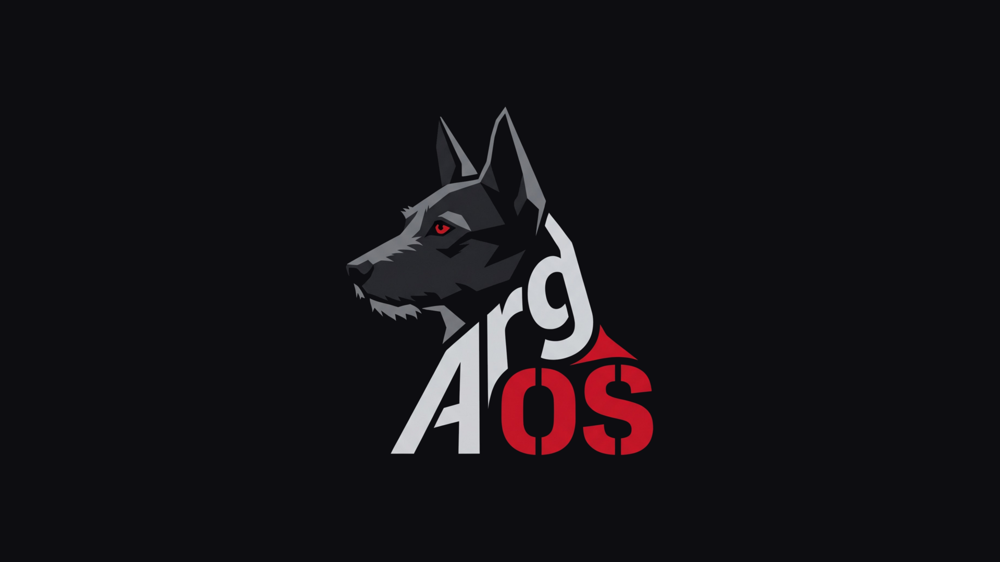

<p align="center">
  
</p>

# ArgOS

ArgOS is a Kali-rolling-based security/pentesting live distro, built with
[live-build](https://wiki.debian.org/DebianLive) (the same tool Kali itself
is built with), bootstrapped directly from Kali's own `kali-rolling`
repository rather than reimplementing anything Kali already maintains. It
ships a real Xfce desktop (Kali's own default), a graphical installer
(Calamares), and an extensive CLI pentest toolset on top.

ArgOS started as a CLI-only, no-desktop live system — that constraint has
since been deliberately dropped in favor of a proper desktop + installer
experience closer to Kali's own live image. Some package-list comments
still describe the CLI-only-era reasoning for excluding specific GUI
tools (Burp, Wireshark's GUI, Maltego, GHIDRA, etc.); those exclusions
haven't been revisited yet now that there's a desktop to run them on.

## What's here

```
auto/config                    live-build invocation (distribution, arch, bootloader, mirrors)
auto/clean                     wrapper around `lb clean`
config/package-lists/*.list.chroot   tool sets, one file per category, plus desktop.list.chroot
config/preseed.cfg              debconf answers so the build never blocks on a prompt
config/hooks/normal/*.hook.chroot    default user, sshd-off, boot theming, argos-tools build, cleanup
config/includes.chroot/         files dropped verbatim into the chroot (Plymouth + GRUB themes,
                                 /etc/argos/ config, /usr/src/argos-tools/ original C tooling)
assets/                         logo source + the derived splash images
Dockerfile                      Kali-rolling + live-build build environment
build.sh                        `lb clean && lb config && lb build` wrapper
```

## Building the ISO

This is **not run automatically** — building takes real root, network
access, ~20-30GB of free disk, and 20-60 minutes.

On a real Debian/Kali host, as root:

```bash
sudo ./build.sh
```

Or via Docker (the container needs `--privileged` because live-build does
chroot/mount/loopback work that an unprivileged container can't):

```bash
docker build -t argos-os-builder .
docker run --rm --privileged -v "$PWD:/build" argos-os-builder -c "cd /build && ./build.sh"
```

The resulting `.iso` lands in the project root.

`build.sh` runs `scripts/argos-preflight.sh` first automatically: it
checks every package in `config/package-lists/` against the live
`kali-rolling` archive before committing to the full build. This exists
because it happened to us directly building ArgOS itself — `nikto` and
`wpscan` were verified present when their list was written, then simply
gone from the archive by a later build attempt (a rolling release has
no staging/QA layer, so packages can disappear or get renamed with no
warning). Catching that in 10 seconds beats finding out 40 minutes into
a build. Run it standalone any time with `./scripts/argos-preflight.sh`,
or skip it with `sudo ./build.sh --skip-preflight` if you're confident
the lists are current (or have no network path to the mirror from
wherever this check would run).

`auto/config` and `auto/clean` were verified by actually installing
Kali's real `live-build` package (`1:20250814+kali3`, pulled straight
from `kali.download`) and running `lb clean`/`lb config` against this
repo, not written from flag names recalled from memory or tested only
against Debian/Ubuntu's own packaging of live-build, which uses
different flag spellings for several of these (plural vs. singular
`--architecture`/`--binary-image`/`--bootloaders`, and
`--debootstrap-options` vs. `--bootstrap-keyring`) and lacks others
entirely. If `lb config` errors on a different live-build version, run
`lb config -u` to see what that version actually accepts.

## Performance choices

Two deliberate speed decisions, both config/hooks-level (no custom
packaging needed):

- **`--chroot-squashfs-compression-type zstd`** in `auto/config`. The
  live root filesystem is read through this compression on every file
  access while running from USB/live media, not just once at boot;
  `zstd` decompresses markedly faster than live-build's `xz` default for
  a modest size cost, which is almost always the right trade for a live
  OS (build-time compression ratio barely matters; runtime decompression
  speed does, constantly).
- **`config/hooks/normal/0250-disable-background-timers.hook.chroot`**
  masks `apt-daily.timer`/`apt-daily-upgrade.timer` (shipped by the `apt`
  package itself) so a live session never spends boot-time I/O on them,
  and — more importantly — never silently mutates packages mid-engagement
  via an unattended background upgrade.

## Package categories

Most of `config/package-lists/` predates the desktop/installer pivot and
still deliberately picks CLI tools over GUI ones where Kali's default
toolset ships both — this wasn't revisited when the desktop was added, so
these exclusions are now a historical artifact of the CLI-only era rather
than a hard rule:

| Excluded (GUI)                        | Included instead                          |
|----------------------------------------|--------------------------------------------|
| burpsuite, zaproxy                     | sqlmap, nuclei, ffuf, gobuster, skipfish    |
| wireshark (GUI)                        | tshark, tcpdump                             |
| maltego, zenmap                        | nmap, masscan, amass, recon-ng              |
| armitage                                | metasploit-framework (msfconsole)           |
| ghidra, cutter                          | radare2, gdb, objdump, binutils             |
| johnny, hydra-gtk                       | john, hydra                                 |
| ettercap-graphical                      | ettercap-text-only                          |
| cherrytree                              | (plain text/markdown notes — no GUI notetaker shipped) |
| autopsy                                 | sleuthkit, testdisk, foremost, scalpel      |

Categories: `base`, `recon`, `web`, `exploit`, `password`, `wireless`,
`forensics`, `reverse-engineering`, `post-exploit` — **277 distinct
packages across 9 files**, not just a hand-picked starter set. The bulk of the
breadth comes directly from Kali's own `kali-linux-headless` metapackage
(the official metapackage Kali itself ships for exactly this use case:
every tool from `kali-linux-default`/`kali-linux-everything` *except* the
GUI ones) — ArgOS pulls its ~190 packages apart into the category files
above instead of depending on it as one opaque blob, so the lists stay
readable and independently auditable. `base.list.chroot` also pulls
`kali-linux-core` + `kali-system-cli` directly, so ArgOS's base system
tracks Kali's own definition of "core," not a guess at one.

**Every package name in every list was verified against the live
`kali-rolling` archive** (`https://kali.download`, main + contrib +
non-free + non-free-firmware components) **on 2026-11-11** — not just
recalled from memory. Two exceptions are called out explicitly in
`web.list.chroot`: `nikto` and `wpscan` are commented out because they
were confirmed *absent* from the amd64 archive on that date (likely a
transient rebuild/transition gap — `kali-linux-headless` itself still
hard-depends on both upstream, so Kali's own metapackage would currently
fail to install too). Re-check `apt-cache policy nikto wpscan` against a
current mirror and uncomment them once they're back.

Package sets drift on a rolling release — if you build significantly
later than the verification date above, re-run a similar check (or just
`apt-get update && apt-get install -s <package-list contents>` as a dry
run) before committing to a full `lb build`.

## Default login

The live image creates one user: **`argos` / `argos`**, with passwordless
sudo. This is a deliberate, published default to get a live/USB session
booted — it is **not safe** on anything beyond a throwaway session:

```bash
passwd argos
```

do this (and review `/etc/sudoers.d/argos-nopasswd`) before trusting the
machine with anything sensitive, especially before installing it to disk or
putting it on an untrusted network. A MOTD reminder is baked in as well.

## Desktop and installer

The live session boots into Xfce (via `kali-desktop-xfce`, Kali's own
official metapackage — not a hand-picked set of Xfce components) and
auto-logs-in as `argos` (`config/includes.chroot/etc/lightdm/lightdm.conf.d/`),
matching Kali's own live-image behavior — no password prompt for a
throwaway/live boot. This has no bearing on the password-change warnings
above, which are about `sudo`/remote-login risk, not desktop auto-login.

There's an **Install ArgOS** icon on the desktop
(`config/includes.chroot/etc/skel/Desktop/install-argos.desktop`) that
launches Calamares, the same graphical installer Kali's own live image
uses — real partitioning, disk encryption options, locale/timezone, and
actual user-account creation, replacing the fixed `argos`/`argos` login
with whatever the person installing picks.

This is new and unverified end-to-end: every package name here was
checked against Kali's live repository the same as everywhere else in
this repo, and the `lightdm`/Calamares configuration follows standard,
widely-used patterns, but — unlike the CLI tooling and the boot
splash — nobody has actually watched this boot into a graphical session
yet. Treat the first real build with this as a test, not a known-good
state.

## Branding

Per explicit direction: no visible "Kali" where it's realistically
avoidable, and a look distinct from a stock Kali/Debian desktop. What's
actually overridden, and why each path was chosen (checked against the
real packages' files, not assumed):

- **`/etc/os-release` + `/usr/lib/os-release` + `/etc/lsb-release`** —
  identifies as "ArgOS" to `neofetch`, `hostnamectl`, `lsb_release`, and
  anything else that queries OS identity. Written to both `os-release`
  locations since Debian normally symlinks one to the other and which
  one is real vs. symlinked can vary.
- **`/etc/issue` / `/etc/issue.net`** — the pre-login text banner.
- **GRUB menu** — `GRUB_DISTRIBUTOR="ArgOS"` added alongside the existing
  theme/background config.
- **Login screen (lightdm) background** —
  `config/includes.chroot/etc/lightdm/lightdm-gtk-greeter.conf` points
  `background=` at ArgOS's own logo-on-flat-background image instead of
  Kali's default wallpaper, rather than overwriting Kali's actual
  wallpaper files in place.
- **Desktop wallpaper** — `config/includes.chroot/usr/local/bin/argos-set-wallpaper`,
  run once per session via `/etc/xdg/autostart/`. This discovers
  whichever `xfce4-desktop` xfconf properties actually exist on the
  running monitor/workspace setup and points them at ArgOS's background,
  rather than shipping a static XML with a hardcoded monitor name (which
  only works on whatever hardware/VM it was written for).

**What's deliberately *not* touched**, because doing it properly is real
design/engineering work, not a config override, and claiming otherwise
would be dishonest:

- The GTK widget theme and icon set are still Kali's own
  (`kali-themes`/Flat-Remix) — building a genuinely different-looking
  theme from scratch is a real design undertaking, not something to fake
  with a quick swap.
- The Xfce "Whisker Menu" still has Kali's own application-category
  structure (`kali-menu`'s `.directory` files) and branding.
- Firefox ESR's default start page/search config is whatever
  `kali-themes`/Kali's Firefox config package sets, unchanged.
- **Package names themselves** (`kali-archive-keyring`, `kali-desktop-xfce`,
  `kali-linux-core`, `kali-tools-*`, etc.) still say "kali" — that's the
  direct tradeoff of bootstrapping from Kali's actual repository instead
  of forking/repackaging everything, which was the explicit choice made
  earlier in this project over building independent package
  infrastructure. `dpkg -l` and the apt sources will show it even though
  the visible OS identity, boot sequence, and login/desktop background
  don't.

## SSH

`openssh-server` is installed but **disabled and masked** by default — it
will not listen on boot. Host keys are deleted at build time and
regenerated fresh on first boot via a oneshot systemd unit, so every image
doesn't share the same key pair. Enable it explicitly if you want it:

```bash
sudo systemctl unmask ssh.service
sudo systemctl enable --now ssh.service
```

## Firewall

Kali ships `nftables` as an installable package, but not actually
configured to deny anything — installed with no policy set means it
accepts everything, so nothing is filtered unless you configure it
yourself. ArgOS ships a real default: `/etc/nftables.conf` denies all
inbound traffic by default (loopback, established/related connections,
and ping still work), allows all outbound, and the `nftables.service`
that loads it is enabled at boot
(`config/hooks/normal/0260-enable-firewall.hook.chroot`).

To open a port for something you're actively running (a callback
listener, serving a payload):

```bash
sudo nft add rule inet argos_filter input tcp dport 4444 accept
sudo systemctl reload nftables
```

Ad-hoc `nft add rule` changes don't persist across reboots — the
ruleset reloads fresh from `/etc/nftables.conf` every time, so add
anything you want to keep to that file directly.

## Boot splash

Plymouth shows a static logo centered on a flat near-black background,
with a real boot-progress bar underneath it, via Plymouth's `script`
module (`config/includes.chroot/usr/share/plymouth/themes/argos/`). The
logo itself is placed once and never touched again (no
`Plymouth.SetRefreshFunction()` callback, which is what every purely
decorative animated theme uses to update frames) — only the progress bar
updates, driven by `Plymouth.SetBootProgressFunction()`, the real
boot-progress callback every script-based theme uses, not a generic timed
animation. `script.so` ships in Kali's base `plymouth` package, confirmed
by extracting the real `.deb` rather than assumed — unlike `image` (not a
real module at all here) and `two-step` (real, but only via the separate
`plymouth-themes` package, and its own shipped themes don't demonstrate a
static-only config worth trusting blind). Both the static-logo and
progress-bar script patterns are adapted from Kali's own shipped `script`
example theme (`/usr/share/plymouth/themes/script/script.script`), not
written from memory. The progress bar's fill color is sampled directly
from the logo's own red (`#cf1324`), not picked by eye.

The same logo is reused as a GRUB background/theme
(`config/includes.chroot/boot/grub/themes/argos/`) for the installed
system's boot menu, applied via `GRUB_THEME` in
`/etc/default/grub.d/argos-theme.cfg`.

Both images were generated from `assets/argos-logo-source.jpg` by cropping
to the head+wordmark, flood-fill alpha-masking out the near-black
background, and compositing onto flat `#0d0d11` canvases
(`assets/plymouth-logo-1920x1080.png`, `assets/grub-logo-1024x768.png`).

## ArgOS's own tooling

Unlike everything else in this image, these two are original — written for
ArgOS, not pulled from Kali. Source lives in the image itself at
`/usr/src/argos-tools/` (a normal FHS location for exactly this), and
`config/hooks/normal/0150-build-argos-tools.hook.chroot` compiles and
installs them at image-build time via `make install`. Both are plain C,
built with only `gcc`/`make`/libc (no linked HTTP/JSON library — see
below) and both were compiled and exercised locally before being added
here.

### `argosd` — hardening daemon

A systemd service (`argosd.service`, enabled by default) that:

- Applies a handful of kernel-hardening sysctls at startup (`rp_filter`,
  disabling source-routed packets/ICMP redirects, `kptr_restrict`,
  `dmesg_restrict`, `yama/ptrace_scope`, SYN cookies).
- Every 60 seconds, checks two things: whether the `argos` user's password
  still matches ArgOS's known default hash (see the comment in
  `config/hooks/normal/0100-create-argos-user.hook.chroot` — the hash is
  fixed/reproducible across builds specifically so this comparison works),
  and whether sshd is listening on port 22 (read directly from
  `/proc/net/tcp{,6}`, no shelling out).
- If **both** are true at once — sshd reachable *and* the default
  credentials still work — it logs a `LOG_CRIT` syslog entry and
  broadcasts a warning to every terminal via `wall`. Either alone just
  gets a quieter log line.
- `argosd --status` prints the last check's result (`/run/argosd.status`)
  without needing root.

### `argos-triage` — recon/triage utility

```
nmap -oG - -p- <target> | argos-triage
argos-triage -i scan.gnmap --ai
```

Parses nmap greppable (`-oG`) output, matches each open port's
service/version against `/etc/argos/triage-rules.csv` (service substring,
version substring, severity, note — edit this file to extend the
ruleset; it's reloaded on every run, no recompiling), and prints a
severity-ranked, colorized report (CRITICAL first). The shipped ruleset is
a small, accurate starter set (known historical backdoors/RCEs like
vsftpd 2.3.4 and the Samba `usermap_script` bug, cleartext-protocol
warnings, a few "worth a second look" service flags) — not a
vulnerability database.

**`--ai`**: this is where the AI feature lives. If `ARGOS_AI_API_KEY` is
set in the environment, the plain-text report (colors stripped,
regardless of terminal settings) is sent to an LLM for a prioritized,
prose summary. Endpoint/model are configurable in `/etc/argos/ai.conf`
(defaults to Anthropic's Messages API); the key itself is **never** read
from that file or passed on the command line — only the environment
variable — and never touches `argv`/`ps` output: the request is made by
shelling out to `curl` with the API key written to a 0600 temp file via
curl's `--config`/header mechanism, unlinked immediately after. With no
key set, `argos-triage` still works fully offline (rule-based triage
only) and just says how to enable the AI step.

### Extending either one

Both are small, single-file C programs (`argosd/argosd.c`,
`argos-triage/argos-triage.c`) with no build system beyond the one
`Makefile`. `cd /usr/src/argos-tools && make` rebuilds either; `argos-tools`
ships in the image as source specifically so this is possible on a live
system, not just at ISO-build time.

## License

MIT — see [LICENSE](LICENSE).
